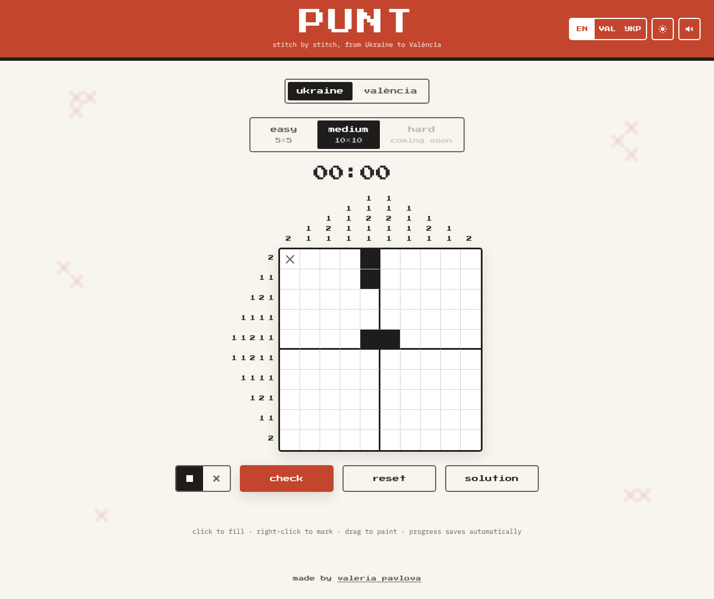
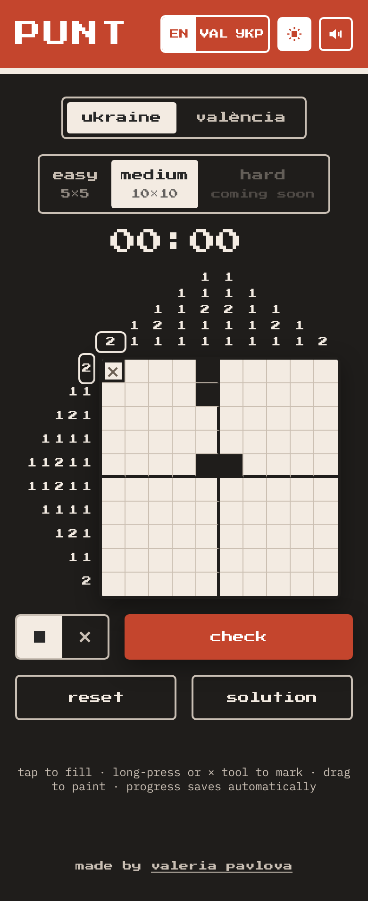
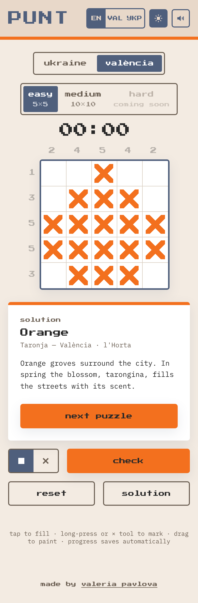
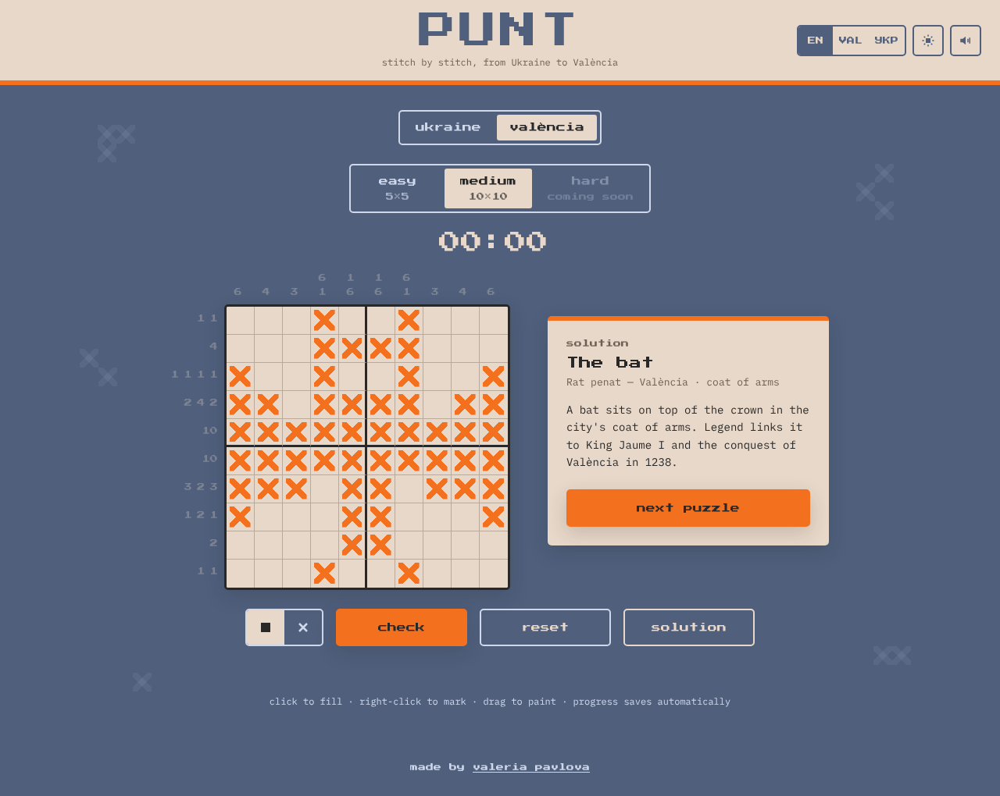

# Punt

**Stitch by stitch, from Ukraine to València.**

*Punt* is Valencian for “stitch” or “dot”. It's a nonogram game where the grid is a cross-stitch chart: every cell you fill is one stitch. When you solve a puzzle, the black pixels turn into embroidered crosses and you get the story of the motif.

**▶ [Play the live demo](https://valeriapavlova.github.io/nonograms-game/)**



## Concept

A nonogram chart and a cross-stitch chart are the same thing: a square grid where each cell is either stitched or left as bare linen. **Stitch = pixel.** I built the game on that idea and on the two places it connects:

- **Ukraine** — motifs from *vyshyvanka* embroidery and *pysanky*: *Wolf's teeth* (a protective border) and *Sown field* (a wish for a good harvest).
- **València** — symbols of the city: the *orange* of l'Horta and the *rat penat*, the bat on the city's coat of arms.

The game uses the same pixel-and-thread language in its UI: a pixel typeface, a grid on linen, and a cross-stitch reveal when you win.

## Features

- Two collections (Ukraine, València) with **easy 5×5** and **medium 10×10** puzzles. **Hard 15×15** is locked and shows a visible “coming soon” label.
- Every puzzle is checked by a solver to have **exactly one solution**.
- **Three languages**: English, Valencian, Ukrainian. All UI strings live in one file, `src/i18n.js`. On the first visit the language follows the browser.
- **Two palettes per collection**: a native one and an alternative one, toggled with the sun button.
- Mouse: click to fill, right-click to mark, drag to paint. Touch: tap, long-press to mark, or use the × tool.
- **Keyboard**: arrow keys move, Enter or Space fills, X marks. The board takes a single Tab stop (roving tabindex).
- Solved rows and columns fade their clues. The row and column under the pointer are highlighted.
- **Check** outlines and hatches wrong cells, and says “no mistakes so far” or “N mistakes”. The message is also announced to screen readers.
- Timer and best time per puzzle.
- **Progress saves automatically**: the board on every move, the timer every 5 s and when the tab is closed. Language, palette and sound settings are remembered too.
- **Win animation**: the stitches “sew in” diagonally. With `prefers-reduced-motion` they appear without animation.
- Optional 8-bit click sound, off by default.

<p>
  
  
</p>



## Design decisions

### A palette per collection

Each collection has its own colors, so switching collection changes the mood. Each one also has an alternative palette. That palette is part of the collection, not a generic dark mode, so the game does not follow `prefers-color-scheme`.

| Collection | Native | Alternative |
|---|---|---|
| **Ukraine** | White linen, red `#c4452d` and black `#1f1d1b` thread — the classic vyshyvanka pair | Dark, inspired by Borshchiv black-on-black embroidery |
| **València** | Navy `#4f5f7c`, linen `#e8d8c9`, orange `#f3701e` — from my original Figma frames | Light linen with navy stitches |

All colors are CSS custom properties on `:root`. Each palette is one attribute selector (`[data-collection][data-mode]`) that reassigns the role tokens: `--bg`, `--text`, `--cell-fill`, `--accent` and so on.

### Why there is no blue in the Ukraine collection

White + blue + red reads as the Russian flag. For a Ukrainian collection that is not a neutral color choice, so Ukraine uses only **red, black and white linen**. That is also the most traditional embroidery palette. Blue appears only in the València collection, as the navy of the original design.

### Contrast (WCAG 2.2 AA)

| Pair | Ratio |
|---|---|
| Ukraine native — text on linen | 13.5 : 1 |
| Ukraine native — white on red buttons and header | 5.0 : 1 |
| Ukraine alternative — text on dark | 14.2 : 1 |
| València native — linen text on navy | 4.6 : 1 |
| València native — muted text `#d0d9ec` on navy | 4.5 : 1 |
| València native — ink on orange button | 5.0 : 1 |
| València alternative — text on linen | 12.5 : 1 |
| “Marked” cross `#6b5f53` on any cell | ≥ 4.4 : 1 |

Fixes I made along the way:

- The original muted blue `#9aaed2` on navy was 2.9 : 1. It is now `#d0d9ec`.
- Linen text on the orange button was 2.1 : 1, so the primary button uses ink instead. Orange is only for the single primary action.
- Orange as a focus ring was 2.2 : 1 on navy. Focus now uses the text color at 4px. On cells it is a two-tone ring (dark + light) that stays visible on both empty and filled cells.
- Wrong cells get hatching as well as the accent ring, so the state is not shown by color alone.
- Clue hover is a ring around the numbers instead of a color change, so the digits keep full contrast.
- The Ukraine tagline was raised from 4.37 to 4.6 : 1. Small text is at least 10px.

### Accessibility notes

- The board is a labelled group. Each cell is a `<button>` whose label includes its position and state, e.g. “Row 3, column 1, filled”.
- The timer is not a live region, so it isn't read every second. Wins and check results are announced politely.
- The locked hard level uses `aria-disabled` instead of `disabled`, so keyboard and screen reader users can still reach it and hear “coming soon”.

## Stack

Plain **HTML, CSS and vanilla JavaScript** (ES modules). No frameworks, no build step, no `!important`. Fonts: Press Start 2P, Pixelify Sans (Cyrillic) and IBM Plex Mono, from Google Fonts. Node is used only for the puzzle checker.

```
index.html              markup
style.css               design tokens, palettes, components
src/
  main.js               state and event wiring
  game.js               pure game logic (no DOM) — shared with the checker
  puzzles.js            all puzzles + LEVELS
  i18n.js               all interface strings (en · ca · uk)
  storage.js            localStorage (progress, best times, settings)
  ui.js                 rendering
scripts/
  check-puzzles.js      verifies every puzzle has exactly one solution
  screenshots.cjs       renders README screenshots, OG image, PNG icons
design/
  punt-design.html      the original prototype — design reference
  og-image.html         source of assets/og-image.png
```

## Run locally

ES modules need a server, so opening `index.html` from disk won't work:

```bash
npm start
```

Then open http://localhost:8000. Any static server works.

## Adding puzzles (and unlocking hard 15×15)

1. Open `src/puzzles.js` and add a `hard` entry to a collection, in the same format as the others. `grid` is 15 strings of 15 characters, with `#` for a stitch and `.` for empty.
2. Run the checker:

   ```bash
   npm run check
   ```

   It checks the size, the characters, the texts in all three languages, and that the clues have **exactly one solution**. If anything fails, it exits with code 1.
3. That's it: the **hard** button unlocks by itself for that collection. Collections without a hard puzzle keep showing “coming soon”.

## Publishing on GitHub Pages

1. Merge the pull request into `main`.
2. On GitHub, open the repository's **Settings → Pages**.
3. Under **Build and deployment**, set **Source** to **Deploy from a branch**.
4. Choose **Branch: `main`**, folder **`/ (root)`**, and click **Save**.
5. After a minute or two the site is live at `https://valeriapavlova.github.io/nonograms-game/`. Settings → Pages shows the link.

The empty `.nojekyll` file tells Pages to serve the files as they are. The Open Graph tags in `index.html` point to that URL. If the repository or user name changes, update `og:url` and `og:image`.

## Credits

Concept and design by [Valeria Pavlova](https://va-pavlova.com). Built with Claude Code.
